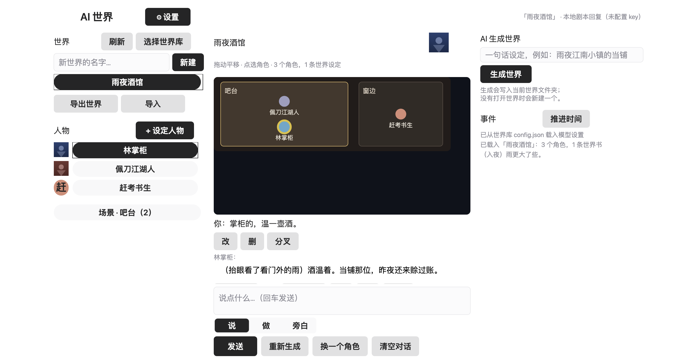

# AI World



一个以文字对话为核心的 **AI 世界引擎**：整个数据库就是你硬盘上的一个
**文件夹**，每个世界是库里的一个子文件夹、由几个 Markdown 文件组成。
你可以在界面里新建世界、设定人物、和角色以文字对话；配上一个
OpenAI 兼容的模型端点后，还能让 AI 从一句话生成整个世界的图文设定。

Web 是主演示面（wasm-gc + WebGPU）；macOS Skia 是原生路线。

## 运行（Web）

```sh
# 仓库根目录（本示例是 moon.work 成员，直接解析工作区框架）
moon build examples/ai_world/web_wasm --target wasm-gc
python3 -m http.server 8080 --bind 127.0.0.1
# 打开 http://127.0.0.1:8080/examples/ai_world/web_wasm/index.html
```

要求支持 WebGPU 的 Chromium 系浏览器（无 WebGPU 时共享运行时会退到
Canvas2D 渲染）。macOS 原生：`moon run examples/ai_world/macos_skia --target native`。

## 第一次使用

1. **选择世界库**——选一个文件夹作为世界库（浏览器支持目录句柄时直接授权；
   否则退到页面内等价的库存储）。授权过的文件夹会记在 IndexedDB 里，
   **刷新页面不用重新选**；只有浏览器收回了授权时才需要再点一次。
2. **新建世界**——起个名字，程序在库里建出模板文件夹并落盘。名字里的
   路径符号会被替换成 `_`（世界名就是文件夹名，不能借此跑到世界库外面）。
3. **设定人物**——名字 + 人设（必填），外貌/说话方式/目标/秘密可选；
   创建后角色立即进入世界，点选即可对话。
4. **模型**——右上角「⚙ 设置」进入设置页，填 OpenAI 兼容端点、模型名与
   API key、温度与**上下文规模**（紧凑/标准/宽裕——影响历史保留量与记忆
   压缩压力）；「保存设置」把端点/模型/温度/上下文规模以 JSON 写到世界库
   根目录的 `config.json`，刷新后自动恢复。**API key 不落盘**：它只存在于
   本次会话的内存里（`config.json` 在普通文件夹里，可能被备份或分享），
   重新打开应用后需要再填一次。
   没有完整配置时对话走**本地剧本回复**，世界离线可玩。
   请求会带上**完整规划好的消息序列**（人设系统提示 → 「此前」摘要 →
   世界书命中 → 预算内的历史 → 玩家这一句），所以多轮对话是连贯的；
   对话超出预算时，最老的片段会自动压写成「此前」记忆笔记随请求携带；
   遇到值得长期记住的事，AI 会递交**记忆草稿**，由你采纳进世界书。
5. **AI 生成世界**——一句话设定（例如「雨夜江南小镇的当铺」）交给模型，
   生成背景叙述、人物卡、世界书与地图地点，写入当前世界文件夹。

## 数据库：一个文件夹，多个 Markdown

```
<世界库>/
  <世界名>/
    world.md                  # H1 世界名，背景叙述（自由 Markdown）
                              # 可选 `## 地图`（尺寸）与 `## 地点`（地图坐标）
    characters/<角色名>.md    # 一人一卡：## 人设/外貌/说话方式/目标/秘密/位置/所在
    characters/<角色名>.png   # 可选立绘，与卡片同目录；卡片里只存文件名
    world_book.md             # 触发条目，可带 priority/position/recursion/probability
    conversations/<键>.json   # 每个角色（或每个场景）一段对话
    events.json               # 事件日志，最新在前
```

- 这些文件**就是**数据库：任何编辑器改完，重新打开世界即生效。
- 读取世界时会一并读回 `conversations/*.json` / `events.json`，以及
  `characters/*.png`（两个宿主按同一规则过滤：`is_world_file_name` 收
  `.md`/`.json`，`is_portrait_file_name` 收 `.png`/`.jpg`/`.jpeg`/`.webp`），
  所以重开世界能恢复对话、事件与立绘，而不是只剩 Markdown 世界内容。
- 解析全部容错：单个文件坏了只降级该文件并给出事件提示；缺 `world.md`
  或无 H1 名字的文件夹不被当作世界；指向已不存在角色的对话单独丢弃并提示。
- 所有世界改动（新建、新角色、AI 生成）都即时写回文件夹；发送与回复走
  **增量写入**：只重写这一段对话的 `conversations/<角色>.json` 与
  `events.json`，不再每次全量重写整个世界（`effect.mbt` 的 `CommitScope`）。
- 对话历史按角色分文件：`conversations/<键>.json`。键是角色 id，场景则是
  `scene:<地点 id>`，分支是 `<角色>~N`。老版本写的单个 `conversations.json`
  仍然会被整份读入以兼容，混合状态可以直接升级——但它已不再被写入。
- **导出 / 导入**：一个世界可以导出成单个 `.aiworld.json`（Markdown + 对话
  + 事件；不含 `config.json`），在另一台机器导入即恢复整个世界。导入永远
  建新文件夹（`名字 (2)`），不会覆盖已有世界。
- `world.md` 的 H1 是世界名，文件夹名是库里的条目名。地点行格式为
  `- 名称 [id=slug]: x=.. y=.. w=.. h=..`（地图逻辑坐标，默认 640 × 420，
  可用 `## 地图` 的 `- 尺寸: w=.. h=..` 改）；`id=` 只在 id 与显示名不同时
  写出，保证带空格或非 ASCII 的地点名在重载后仍能匹配。

## 架构

| 部分 | 位置 |
|---|---|
| 世界/角色/世界书（纯数据 + Markdown codec） | `app/world_store.mbt`、`app/scenario.mbt`、`app/scenario_codec.mbt` |
| 对话与事件日志的 JSON 落盘（`conversations/<角色>.json` / `events.json`） | `app/journal.mbt` |
| 世界导出/导入的 bundle 格式 | `app/bundle.mbt` |
| 消息协议与页面枚举（与 `update` 分离，供死 UI 闸门扫描） | `app/msg.mbt` |
| 提示词组装（预算内截取、世界书命中注入） | `app/context.mbt` |
| 对话簿（按角色封顶的历史） | `app/conversation.mbt` |
| 请求构造与回复解析（纯函数）；请求携带完整消息数组 | `app/llm.mbt` |
| 模型设置页（`config.json` 读写） | `app/view.mbt`（`settings_view`）、`app/update.mbt`（settings 分支） |
| 世界管理/人物创建/AI 生成/消息循环 | `app/update.mbt`、`app/generate_world.mbt`、`app/character_creator.mbt` |
| 宿主 effect（库列表/读世界/增量提交/config 读写/导入导出） | `app/effect.mbt` |
| 无 key 本地剧本回复 | `app/local_reply.mbt` |
| 上下文预算/记忆压缩/长期记忆提议 | `app/context.mbt`（plan_messages·压缩触发·提议提示词）、`app/update.mbt`（SummaryArrived/MemoryProposals/Accept） |
| 三栏产品界面（居中内容块；输入框钉在底边） | `app/view.mbt`、`app/render.mbt` |
| 候选切换 / 编辑 / 删除 / 清空（swipe 模型） | `app/conversation.mbt`（`ChatLine`）、`app/update.mbt` |
| 立绘资产（base64 编解码、`data:` URI 解析） | `app/portrait.mbt`、`app/world_store.mbt`（`portrait_uri`） |
| 场景（在场判定、回应者、场景提示词）与时间推进 | `app/scene.mbt`、`app/update.mbt`、`app/render.mbt`（`location_at`） |
| Lorebook 选取（优先级/位置/递归/概率） | `app/lore.mbt`、`app/world_book.mbt`、`app/world_store.mbt`（修饰符解析） |
| 创建向导（模板 + AI 起草） | `app/character_creator.mbt`、`app/update.mbt` |
| 分支对话（同级文件 + 名单可达） | `app/journal.mbt`（`branched_key`/`split_branch`）、`app/update.mbt`、`app/view.mbt` |
| Web 传输与文件桥（wasm-gc） | `llm_web/bridge.mbt` + `web_wasm/index.html` 内联 `ai_world_host` |
| 原生传输与文件 worker | `llm_native/worker.mbt` + `macos_skia/main.mbt` |

注入契约与宿主边界：共享 `app` 包是纯 TEA 包——`TurnRunner`（provider
请求）与 `WorldHost`（库列表/读世界/写世界）都由平台入口注入，`update`
只准备请求、消费类型化结果，网络或写盘失败永远只是事件面板里的一条
提示，不会破坏世界。Web 上字符串按 `begin_create_string`/`begin_read_string`
握手过界，完成经导出的 `ai_llm_complete`/`ai_fs_complete` 回到 wasm
（与剪贴板异步回调同款协议）；不支持目录句柄的浏览器退到页面内等价库。
boot 期间到达的完成回调会先入队、字符串 id 延迟到队列重放后再释放——
否则 wasm 侧读到的是已经被删掉空字符串。
`update` 是纯函数：分支里要改日志/对话簿时从 `model.fork()` 开始（数组是
引用，`{ ..model, }` 会写穿入参）。
原生侧复用 `moonbitlang/async` 的 worker 队列模式，世界库默认在
`./ai_world_library`，「选择世界库」会打开 macOS 目录选择框并即时切换库根。

## 角色创建向导

点「+ 设定人物」不再是一张空表单：

- **模板一键填**：掌柜 / 旅人 / 官差 / 陌生人，点一下就把人设、说话方式、
  目标、秘密都填好，你再改。**已经打好的名字不会被覆盖**。
- **一句话起草**：写一句描述（"一个卖伞的老太太"），点「起草」，模型按世界
  名产出整张卡。没有 key 时会退回模板并说明，不会假装生成。
- 起草只补空缺：你已经填的字段保留，模型返回的不是角色卡就整段忽略并提示。

## 分支对话

每条历史右侧有「分叉」：保留到这一条为止的历史，**开一段新的同级对话**，
原来那段一字不动。

- 分支在磁盘上是**同级文件**（`conversations/林掌柜~2.json`），不是 JSON 树——
  "世界是一个可读的文件夹"这条承诺不能破。
- 左侧名单里，角色下面会列出它的分支（`↳ 分支 2（4 条）`），点一下就能切回去；
  再点角色名回到主对话。
- 分支可以和主对话一样重生成、编辑、删除、清空。

## 输入意图：说 / 做 / 旁白

输入框上方有三个模式（借自 AI Dungeon）：

| 模式 | 送给模型的形式 | 用来做什么 |
|---|---|---|
| **说** | 原文 | 普通对白，角色会回答你 |
| **做** | `*动作*（请回应它的后果，不要当成对白）` | 描述一个动作，让世界反应 |
| **旁白** | `（旁白）…（请接着往下写）` | 你来叙述，模型续写而不是回话 |

- 只改变**送给模型的那一句**的框法；存档里仍是你原样打的字。
- 同一个功能在离线剧本模式下也生效（动作会得到动作式回应）。

## 世界书（Lorebook）

一行一个条目，基础形式还是最简的：

```markdown
- 酒 | 花雕: 后堂埋着一坛三十年的女儿红。
```

需要更细的控制时，在关键词后面加**可选**修饰符（顺序任意、大小写不敏感）：

```markdown
- 花雕 [priority=8] [position=before]: 规矩：只温不冰。
- 雨 [probability=25] [recursion=1]: 雨天路上不会有旅人。
```

| 修饰符 | 作用 | 默认 |
|---|---|---|
| `[priority=N]` | 越大越先注入，预算紧张时也最后被裁掉 | `0` |
| `[position=before]` | 放进系统提示**最前面**（世界规则）；不写则放在历史之前（场景事实） | `after` |
| `[recursion=N]` | 允许**链式触发**：注入的内容再触发别的条目（最多 4 层） | `0` |
| `[probability=N]` | 命中后按 N% 概率注入；**同一条目在同一轮结果固定**，重试不会重掷 | `100` |

- 只写非默认值，所以普通条目写回文件时仍是原来那一行。
- 坏值或未知修饰符只会被忽略/夹紧，**不会让你丢掉整个条目**。
- 离线剧本回复走同一套选取逻辑，所以有 key 没 key 看到的设定一致。

## 场景（多角色同场）

- 同一个地点站着 2 个以上角色时，左侧会出现「场景 · 地点（N）」；点进去，
  这一屋子人就在**同一段对话**里说话，每行都标出是谁说的。
- 也可以直接点地图上的地点进入；点**人**仍然是私聊。人优先于地点。
- 场景里的人轮流回应：先看玩家有没有点名，没点名就按**回合**顺序轮转
  （一轮换一位，不是一轮里换好几次）——不额外多花一次模型调用去"决定谁说话"。
- 场景记录存在 `conversations/scene:<地点>.json`，和私聊互不影响。
- **推进时间**：右侧事件区有「推进时间」按钮，让模型写一段"你离开这段时间
  发生了什么"，以「（这段时间）…」落进事件日志。它是**显式动作**，不是
  后台定时器——provider 调用要花钱，不该由时钟触发。

## 人物立绘

- 把角色图片放进世界文件夹（`characters/林掌柜.png` 或世界根目录都行），
  在角色卡里写一段：

  ```markdown
  ## 立绘

  林掌柜.png
  ```

- 名单里显示圆形小头像，舞台右上显示方形头像；**没有立绘时**回落到按名字
  生成的色块 + 名字首字，不会出现破图。
- 卡片里只存文件名——图片本身是文件夹里的一个文件，Markdown 保持可读，
  也可以用任何编辑器改。
- 导出世界时立绘一起打包；导入后立绘同时恢复。
- AI 生成世界只产出**立绘提示词**（`appearance` 字段），不直接调用图像 API：
  把它粘贴到任意绘图工具，再把生成的图片丢进文件夹即可。

## 对话编辑

- **重新生成**：对最后一条角色回复重新问一次模型，旧回复不会丢——它变成
  候选（swipe），用 `‹ 1/2 ›` 左右切换。没有 key 时走本地剧本，照样能换。
- **改 / 删**：每条历史右侧有「改」「删」。编辑是就地输入框，提交后才写回
  世界；空格或空串不算有效修改。
- **清空对话**：只清空当前角色，别的角色不受影响。
- **世界书命中可见**：玩家这一轮命中了几条世界书会显示在对话末尾，不再让
  角色"莫名其妙就知道"。
- 角色回复按 **Markdown** 渲染（加粗、列表、斜体动作），玩家的话保持原样。
- 候选会随 `conversations/<角色>.json` 落盘，重开世界后仍然可以左右切换。

## 测试

```sh
moon test examples/ai_world/app --target native    # 222 项：codec 往返、容错、
                                                   # 创建/回复两路、设置入库、
                                                   # 日志 JSON 落盘与恢复、AI 生成容错、
                                                   # 记忆压缩与长期记忆提议、
                                                   # 请求携带历史、发送门控、update 纯度、
                                                   # 增量提交、bundle 往返与越界拒绝、
                                                   # 重生成/候选/编辑/删除/清空对话、
                                                   # 立绘 base64 与回落、
                                                   # 场景在场/回应者/时间推进、
                                                   # Lorebook 优先级/位置/递归/概率、
                                                   # 说/做/旁白三种输入意图、
                                                   # 创建向导模板与 AI 起草、分叉对话、
                                                   # 跨特性接缝（场景/分支/立绘/世界书/清空落盘）、
                                                   # 落盘性质护栏（reload∘commit 保持状态）、
                                                   # 纯性护栏（58 条 Msg 全量不写穿入参）、
                                                   # 手改世界后的孤儿历史处理、
                                                   # 长对话上限与摘要连续性、
                                                   # README 里印的语法确实能解析、
                                                   # 请求失败后仍可继续、迟到回复不乱写、
                                                   # 宿主读写失败时的降级、同地多人标记不重叠、
                                                   # 导出的包确实带上立绘
moon test examples/ai_world/render_check --target native   # 12 项：地图坐标、transcript 跟随尾部、
                                                          # 文本不越界、立绘成为 DrawImage、动作行不溢出、
                                                          # 超长回复不横向溢出、世界书命中真的画在屏幕上
moon build examples/ai_world/web_wasm --target wasm-gc
```

调试小技巧：`?renderer=2d` 强制 Canvas2D 渲染（其画布可被脚本读取，适合自动化目验）。

## 路线

见 `docs/plans/active/ai-world-product.md`。已完成：文件夹数据库、人物创建、
双回复路径、Web 优先运行、AI 生成世界、对话/事件日志落盘、跨刷新授权、
增量写入、世界导入导出、对话编辑（重生成/候选切换/编辑/删除/清空）、
世界书命中可见、Markdown 回复渲染、人物立绘、场景多角色同场、显式时间推进。
下一步：毕业为独立仓库（submodule）。
